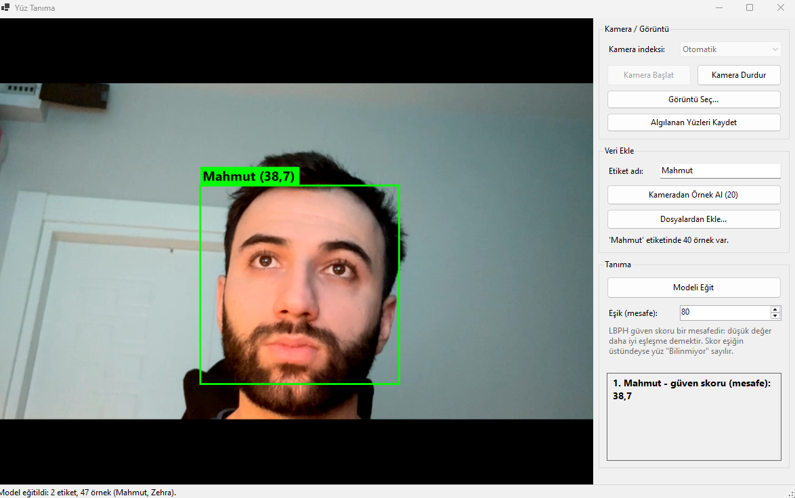
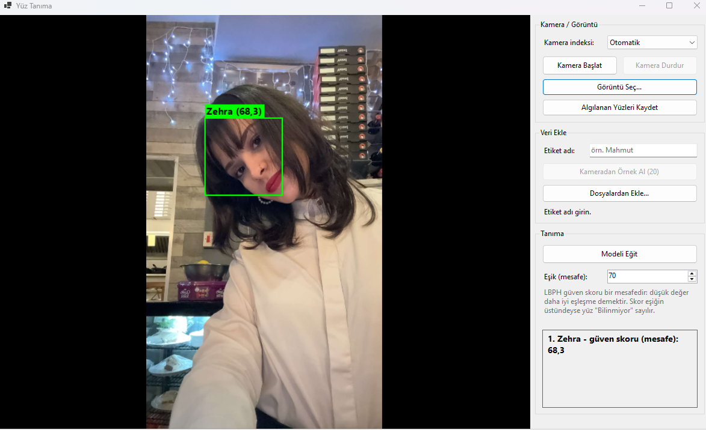

# YMH219-FaceRecognition (Yüz Algılama ve Tanıma)

Kamera görüntüsünde veya seçilen bir fotoğrafta yüzleri bulan ve tanıyan C# Windows Forms uygulaması. Yüzler Haar cascade ile algılanıp dikdörtgenle işaretlenir. Kayıtlı kişiler LBPH algoritmasıyla tanınır; her yüzün üstüne etiket ve güven skoru yazılır. Eğitim verisi uygulamanın içinden eklenir: kameradan 20 örnek alınabilir ya da fotoğraflardaki yüzler kırpılarak bir etikete eklenebilir. YMH 219 Nesne Tabanlı Programlama dersi ek uygulama ödevidir.

## Kullanılan teknolojiler

- C# / .NET 10, Windows Forms (`net10.0-windows`)
- NuGet paketleri:

| Paket | Sürüm | Kullanım |
|---|---|---|
| `OpenCvSharp4.Windows` | 4.13.0.20261107 | OpenCV ve yerel DLL'ler: `VideoCapture`, `CascadeClassifier`, `OpenCvSharp.Face.LBPHFaceRecognizer` |
| `OpenCvSharp4.Extensions` | 4.13.0.20261107 | `Mat` → `Bitmap` dönüşümü (PictureBox'ta gösterim) |

- Algılama modelleri (OpenCV'nin hazır dosyaları, repoda `FaceRecognitionApp/Models/` altında):
  - `haarcascade_frontalface_default.xml`: yüz algılama
  - `haarcascade_eye.xml`: birbirine değen yüz adaylarından doğru olanı seçmek için göz kontrolü

Derlemede bu dosyalar çıktı klasörüne kopyalanır (`Copy to Output Directory: Copy if newer`).

## Kurulum ve çalıştırma

Gereksinim: .NET 10 SDK; tasarımcı için Visual Studio 2026 veya dotnet run. Bir kamera (USB/dahili ya da telefon için Iriun Webcam gibi sanal kamera).

```
git clone https://github.com/mah0cb/YMH219-FaceRecognition.git
cd YMH219-FaceRecognition
```

### dotnet run ile (VS Code)

```
dotnet run --project FaceRecognitionApp
```

### Visual Studio ile

1. `YMH219-FaceRecognition.sln` dosyasını açın.
2. F5 ile çalıştırın. Form tasarımcısı için `FaceRecognitionApp/MainForm.cs` dosyasına çift tıklayın.

### Telefonu kamera olarak kullanma (Iriun Webcam)

Telefonda ve bilgisayarda Iriun Webcam uygulamasını açın, telefonu USB ile bağlayın. Uygulamada **Kamera indeksi** "Otomatik" iken 0–3 arasında kare veren ilk kamera açılır; istenirse indeks elle seçilebilir. Kamera MSMF arka ucuyla 1280x720 açılır, çünkü Iriun varsayılan 640x480'de bozuk renkli görüntü veriyor.

### Veri ekleme ve eğitim

1. **Kamera Başlat**'a basın.
2. **Etiket adı** kutusuna bir ad yazın (örn. `Mahmut`) ve **Kameradan Örnek Al (20)**'ye basın. Kadrajda tek yüz olmalı; başınızı hafifçe çevirin. Örnekler 0,3 saniye arayla kaydedilir.
3. İkinci kişi için etiketi değiştirin ve **Dosyalardan Ekle...** ile fotoğraflarını seçin. Her fotoğraftan yalnızca ana yüz eklenir: gözü görünen adaylar arasından en büyüğü. HEIC desteklenmez; JPG/PNG kullanın.
4. **Modeli Eğit**'e basın. Model `model.yml`, etiketler `labels.json` olarak kaydedilir ve program açılışında otomatik yüklenir.

Veriler exe'nin yanında tutulur (`FaceRecognitionApp/bin/Debug/net10.0-windows/`): `dataset/<etiket>/*.png` (200x200 gri yüzler), `model.yml`, `labels.json`, `detected_faces/`.

## Temel özellikler

- **Kamera Başlat / Durdur**: kare döngüsü arka planda çalışır (`CameraService`, `FrameReady` event'i, `IDisposable`); kamera indeksi ComboBox'tan seçilir veya otomatik bulunur
- **Görüntü Seç**: `OpenFileDialog` ile JPG/PNG/BMP açma; büyük fotoğraflar 1600 piksele küçültülür
- **Yüz algılama**: gri ton + `EqualizeHist` + `DetectMultiScale` (minNeighbors 5, en küçük yüz kısa kenarın 1/15'i, en az 40 px). Aynı karedeki birden fazla yüzün her biri ayrı işaretlenir ve etiketlenir.
- **Tanıma**: LBPH; tahmin edilen etiket ve güven skoru hem yüzün üstüne hem sağdaki sonuç kutusuna yazılır. Renkler: yeşil = tanındı, turuncu = Bilinmiyor, sarı = model yok.
- **Eşik ayarı**: LBPH güven skoru bir mesafedir, düşük değer daha iyi eşleşme demektir. Skor eşiğin üstündeyse yüz "Bilinmiyor" sayılır. Varsayılan 70; arayüzden değiştirilebilir ve sonuç anında güncellenir.
- **Veri Ekle**: kameradan 20 örnek veya fotoğraflardan toplu ekleme; etiket başına örnek sayısı gösterilir
- **Dengeli eğitim**: her etiketten, en az örneği olan etiket kadar örnek rastgele (sabit tohumla) seçilir; 5'ten az örneği olan etiketler atlanır ve kullanıcıya bildirilir
- **Algılanan Yüzleri Kaydet** (isteğe bağlı özellik): ekrandaki yüzleri renkli olarak `detected_faces/` klasörüne kaydeder
- UI güncellemeleri kamera thread'inden `BeginInvoke` ile yapılır; PictureBox'a yeni resim atanınca eski `Bitmap` `Dispose` edilir

### Hata yönetimi

| Durum | Davranış |
|---|---|
| Kamera açılamıyor / indekste kamera yok | "Kamera açılamadı" mesajı, Iriun için ipucuyla |
| Kamera çalışırken bağlantı kopuyor | Kamera durdurulur, Türkçe uyarı gösterilir |
| Cascade XML dosyası yok veya bozuk | "Model Dosyası Bulunamadı" mesajı; algılama kapanır, görüntü gösterimi çalışmaya devam eder |
| Eğitilmiş model (`model.yml` / `labels.json`) yok | Durum çubuğunda "Eğitilmiş model yok" uyarısı; yüzler "model eğitilmedi" olarak işaretlenir |
| Model dosyası bozuk | "Model yüklenemedi, yeniden eğitin" mesajı |
| Eğitim için yetersiz veri (2'den az etiket) | Türkçe hata mesajı |
| Resim okunamıyor / dosya yazılamıyor | Hata mesajı; toplu eklemede sorunlu dosyalar liste halinde gösterilir |
| Beklenmeyen hata | `Application.ThreadException` ile Türkçe mesaj, uygulama kapanmaz |

Resimler `File.ReadAllBytes` + `Cv2.ImDecode` ile okunup `Cv2.ImEncode` + `File.WriteAllBytes` ile yazılır; böylece Türkçe karakterli yollar ve etiket adları (`Ayşe` gibi) sorun çıkarmaz.

### Proje yapısı

| Dosya | Görev |
|---|---|
| `Services/CameraService.cs` | `VideoCapture`, arka plan kare döngüsü, `FrameReady` / `Error` event'leri, Start/Stop, `IDisposable` |
| `Services/FaceDetector.cs` | Yüz ve göz cascade'leri, gri ton + `EqualizeHist`, `DetectMultiScale`, örtüşen adayları eleme, 200x200 kırpma |
| `Services/FaceRecognizerService.cs` | LBPH: dengeli `Train()`, `Predict()`, model.yml / labels.json kaydetme ve yükleme, eşik |
| `Services/DatasetManager.cs` | Yüzleri `dataset/<etiket>/` ve `detected_faces/` klasörlerine kaydetme, dosyalardan ekleme |
| `Services/ImageLoader.cs` | Resim dosyası okuma ve büyük resimleri küçültme |
| `Services/FaceOverlay.cs` | Dikdörtgen ve etiket çizimi (GDI+, Türkçe karakter desteği) |
| `Models/RecognitionResult.cs` | Yüz konumu, etiket, güven skoru, tanındı mı |
| `MainForm.cs` | Arayüz ve olay bağlama |

## Kapsam ve Güvenlik Sınırı

> Bu çalışma yalnızca ders kapsamında yerel ve gönüllü örneklerle yapılmalıdır. Kamuya açık alanlarda izinsiz kimlik takibi, gizli görüntü toplama veya gerçek kişileri uzaktan izlemeye yönelik kullanım yapılmamalıdır.

Bu projede eğitim verisi yalnızca öğrencinin kendi yüzünden ve izni alınan bir arkadaşının fotoğraflarından oluşturuldu. Tüm işlemler yerel bilgisayarda yapılır, görüntüler hiçbir sunucuya gönderilmez. Yüz verileri (`dataset/`, `detected_faces/`, `model.yml`, `labels.json`) `.gitignore`'dadır ve GitHub'a yüklenmez.

## Ekran görüntüleri

**Kamera: kendi yüzüm "Mahmut" etiketi ve güven skoruyla tanınıyor**



**Görüntü Seç: fotoğraftaki yüz etiket ve güven skoruyla işaretleniyor**



## Bilinen sınırlamalar / geliştirme notları

- **Haar cascade yalnızca önden bakan, dik yüzleri algılar.** Profil, eğik (ör. yan yatmış) veya kısmen kapalı (el, telefon, saç) yüzler bulunamayabilir. Uzaktan çekilmiş fotoğraflardaki küçük yüzler de kaçabilir. Arka plandaki desenler (mobilya, duvar) zaman zaman yüz sanılabilir; yalnızca gerçek bir yüze değen yanlış adaylar göz kontrolüyle elenir.
- **LBPH az örnekle ve farklı ışık/kamera koşullarında sınırlı doğruluk verir.** Doku tabanlı bir yöntemdir; kameradan alınan örneklerle eğitilen bir kişi farklı telefonla, farklı ışıkta çekilmiş fotoğrafta daha yüksek mesafe alır. Kişi başına 20 veya daha fazla, farklı koşullarda çekilmiş örnek doğruluğu artırır.
- **Dengeli eğitimin gerekçesi:** LBPH en yakın örneğe bakar. Bir etikette çok örnek varsa (ör. 40'a 8) yabancı bir yüzün o etiketin örneklerinden birine yakın düşme olasılığı artar. Testte modelde olmayan bir kişi "Mahmut (78,7)" olarak tanınmıştı. Bu yüzden her etiketten eşit sayıda örnek kullanılır. Bedeli: az örnekli etiket diğerlerinin kullanılan örnek sayısını da düşürür.
- **Eşik 70'in gerekçesi:** Gerçek dataset üzerinde leave-one-out değerlendirmesi yapıldı.
  - Doğru kişi mesafeleri: Mahmut medyan 40, Zehra medyan 51.
  - Bir kişinin yüzü yalnızca diğer kişiyle eğitilmiş modele verildiğinde çapraz mesafeler: en az 74,9.
  - Zehra'nın eğitimde olmayan fotoğrafları: 66–68.

  70 bu fotoğrafları kabul eder ve Mahmut ile Zehra'yı birbirine karıştırmaz.
- **Yabancılarda yanlış kabul riski:** Modelde olmayan dış yüzler 58–74 mesafe aralığında çıktı (örn. bir test yüzü 58,5, bir diğeri 73,6). Yani eşik 70'te bazı yabancılar en yakın etiketle "tanınmış" görünebilir. Daha güvenli kullanım için eşik 55–60'a düşürülebilir; bu da doğru kişilerin bir kısmını "Bilinmiyor" yapar.
- Kamera görüntüsü MSMF arka ucuyla ve 1280x720 isteğiyle açılır; bazı kameralar bu çözünürlüğü desteklemezse en yakın çözünürlük kullanılır.

## Öğrenci

Mahmut Başcı, 205542016
